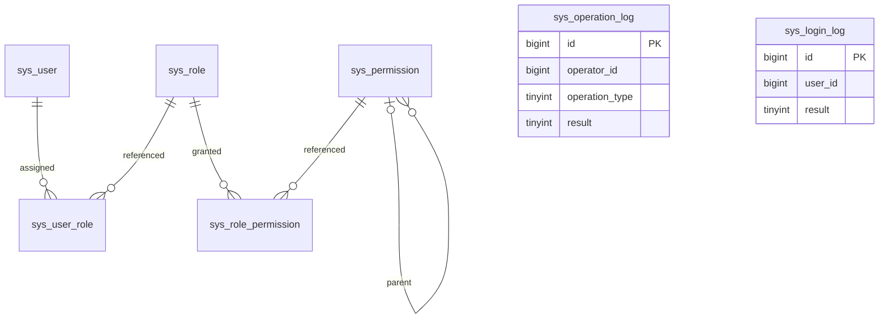

# 数据结构设计：基础后台 RBAC 管理

- 需求编号：XQ20261009-001
- 需求来源：[需求分析](../ai-devlop-spec/需求分析.md)
- 配套：[详细设计](详细设计.md)、[接口设计](接口设计.md)
- 本文全部表、对象为拟新增设计，当前工作区没有业务表或存量数据。

## 1. ER 图

图中用户、角色及权限关联落实为数据库外键，全部 ON DELETE RESTRICT / ON UPDATE RESTRICT；权限父子关系也使用自引用外键。角色删除先显式删除其权限关联，用户关联存在则拒绝删除。用户不删除。根权限 parent_id 为 NULL。登录 Token 信息只存 Redis，不建立数据库会话表。操作记录与登录日志是 MySQL 历史记录，操作人/用户 ID 和目标 ID 仅为逻辑引用，不设外键，避免业务对象变化或删除影响历史；ER 图不将它们画成物理外键关系。

## 2. MySQL

### 2.0 公共约定

- MySQL 8.4、InnoDB、utf8mb4。所有 ID 采用数据库 BIGINT UNSIGNED 自增，关联表使用联合主键；API 以十进制字符串输出 ID，避免 JavaScript 精度丢失。Java 使用 Long，并限制生成 ID 不超过 Long.MAX_VALUE。
- 所有时间由应用写入 UTC DATETIME(3)，API 输出 ISO 8601 UTC，例如 2026-10-09T08:00:00.000Z；前端转换为本地时间。
- 业务枚举使用固定整型编码：用户状态 0=停用、1=启用；权限类型 0=菜单、1=页面、2=操作。数据库 TINYINT、API 整数、Java 使用具名枚举映射，禁止依赖枚举 ordinal 或魔法数字。
- varchar 长度为本次设计的存储容量，接口同等限制；它们不代表用户确认了额外的业务范围。密码不得截断，BCrypt 的输入上限为 72 个 UTF-8 字节，前后端同时校验。
- username 使用 utf8mb4_0900_bin 精确区分大小写；前后空白拒绝，不自动转小写。role.name 也精确判重、拒绝首尾空白，避免不透明归一化。
- 手机号、邮箱为空字符串或纯空白时归一为 NULL；非空联系资料去掉首尾空白。手机号格式为可选 + 号后 6～15 位数字（通用联系方式格式，不限国内号段）；邮箱按常用 email 格式校验，最大 254 字符。不做联系方式唯一校验，也不用于登录。
- 默认值“无默认值”表示 INSERT 必须显式提供；“NULL”表示允许不提供且存空。version 从 0 开始，仅作并发修订号，不属于业务状态。
- 外键字段均不允许悬空。CHECK 约束在迁移中落实。

### 2.1 sys_user

| 字段 | 类型 | 可空 | 默认值 | 说明 |
|---|---|---|---|---|
| id | bigint unsigned | 否 | 自增 | 用户 ID |
| username | varchar(64) COLLATE utf8mb4_0900_bin | 否 | 无默认值 | 登录账号，非空且首尾无空白，创建后不可修改 |
| display_name | varchar(100) | 否 | 无默认值 | 显示名称，非空 |
| password_hash | varchar(100) | 否 | 无默认值 | BCrypt 密码摘要，绝不输出 |
| status | tinyint | 否 | 1 | 0 停用、1 启用 |
| is_super_admin | tinyint | 否 | 0 | 0 普通、1 初始化超级管理员，不接受客户端设置 |
| phone | varchar(16) | 是 | NULL | 可选联系手机号，不唯一 |
| email | varchar(254) | 是 | NULL | 可选联系邮箱，不唯一 |
| version | bigint unsigned | 否 | 0 | 用户资料、状态、密码、角色集合变更时递增 |
| auth_version | bigint unsigned | 否 | 0 | 认证版本，改密、重置密码及从启用改为停用时递增；用于立即使全部旧 Token 失效 |
| created_at | datetime(3) | 否 | 无默认值 | 创建时间 UTC |
| updated_at | datetime(3) | 否 | 无默认值 | 修改时间 UTC |

| 索引名称 | 字段（按顺序） | 类型 | 用途 |
|---|---|---|---|
| pk_sys_user | id | 主键 | 定位及锁定用户 |
| uk_sys_user_username | username | 唯一 | 大小写敏感账号判重与登录检索 |

CHECK：status IN (0,1)、is_super_admin IN (0,1)、is_super_admin=0 OR status=1。超级管理员单例由初始化事务、固定账号唯一键与“存在任何超级管理员则复用”共同保证；不提供创建或修改 is_super_admin 的业务接口。普通写接口不得更新 username。

不为手机号、邮箱建立唯一索引；列表采用 id 倒序分页，基础版无需额外搜索索引。

### 2.2 sys_role

| 字段 | 类型 | 可空 | 默认值 | 说明 |
|---|---|---|---|---|
| id | bigint unsigned | 否 | 自增 | 角色 ID |
| name | varchar(100) COLLATE utf8mb4_0900_bin | 否 | 无默认值 | 唯一非空名称 |
| description | varchar(500) | 是 | NULL | 可选说明 |
| version | bigint unsigned | 否 | 0 | 资料或权限集合变更递增 |
| created_at | datetime(3) | 否 | 无默认值 | 创建时间 |
| updated_at | datetime(3) | 否 | 无默认值 | 修改时间 |

| 索引名称 | 字段（按顺序） | 类型 | 用途 |
|---|---|---|---|
| pk_sys_role | id | 主键 | 查询、更新、锁定角色 |
| uk_sys_role_name | name | 唯一 | 名称判重，包括并发新增 |

角色不设计启停状态；超级管理员身份保存在用户字段中，不依赖某个可删除角色。

### 2.3 sys_permission

| 字段 | 类型 | 可空 | 默认值 | 说明 |
|---|---|---|---|---|
| id | bigint unsigned | 否 | 自增 | 预置权限 ID |
| code | varchar(100) COLLATE utf8mb4_0900_bin | 否 | 无默认值 | 稳定权限代码 |
| name | varchar(100) | 否 | 无默认值 | 中文名称 |
| type | tinyint | 否 | 无默认值 | 0 菜单、1 页面、2 操作 |
| parent_id | bigint unsigned | 是 | NULL | 父权限 ID，根为 NULL |
| route_path | varchar(200) | 是 | NULL | 菜单/页面路径，操作权限为 NULL |
| sort_order | int | 否 | 0 | 同级展示顺序 |
| created_at | datetime(3) | 否 | 无默认值 | 创建时间 |

| 索引名称 | 字段（按顺序） | 类型 | 用途 |
|---|---|---|---|
| pk_sys_permission | id | 主键 | 关联权限 |
| uk_sys_permission_code | code | 唯一 | 预置幂等、代码检索 |
| idx_sys_permission_parent | parent_id, sort_order, id | 普通 | 子节点检索和排序 |

CHECK：type IN (0,1,2)。父树无环由初始化预置定义校验；不提供运行时权限增删改接口。

预置权限结构：
- menu:system（系统管理，type=0，route_path=NULL），作为展示分组。
- user:query（用户管理，type=1，/system/users），父为 menu:system。
- user:create、user:edit、user:status、user:reset-password、user:assign-role（type=2），父为 user:query。
- role:query（角色管理，type=1，/system/roles），父为 menu:system。
- role:create、role:edit、role:delete、role:assign-permission（type=2），父为 role:query。

新增日志权限：menu:audit（日志管理，type=0，route_path=NULL）；operation-log:query（操作记录，type=1，/audit/operations）、login-log:query（登录日志，type=1，/audit/logins），父均为 menu:audit。对应列表与详情均使用该类 query 权限，不增加删除或导出操作权限。

树父子仅用于组织展示，不自动继承授权，也不因勾选父权限授权子操作。前端显式允许“选择子节点但不自动选择父节点”；页面访问需要对应 query 权限，操作需要操作权限。菜单父节点可作为授权页面的展示容器补全，但不因此加入用户有效权限。操作权限未配 query 时 API 仍按该操作权限校验，前端无对应管理页面入口，授权页面说明这一点，避免暗中扩大权限。

### 2.4 sys_user_role

| 字段 | 类型 | 可空 | 默认值 | 说明 |
|---|---|---|---|---|
| user_id | bigint unsigned | 否 | 无默认值 | 外键 sys_user.id |
| role_id | bigint unsigned | 否 | 无默认值 | 外键 sys_role.id |
| created_at | datetime(3) | 否 | 无默认值 | 分配时间 |

| 索引名称 | 字段（按顺序） | 类型 | 用途 |
|---|---|---|---|
| pk_sys_user_role | user_id, role_id | 联合主键 | 去重并按用户读取角色 |
| idx_sys_user_role_role | role_id, user_id | 普通 | 删除角色前检查全部用户关联 |

### 2.5 sys_role_permission

| 字段 | 类型 | 可空 | 默认值 | 说明 |
|---|---|---|---|---|
| role_id | bigint unsigned | 否 | 无默认值 | 外键 sys_role.id |
| permission_id | bigint unsigned | 否 | 无默认值 | 外键 sys_permission.id |
| created_at | datetime(3) | 否 | 无默认值 | 授权时间 |

| 索引名称 | 字段（按顺序） | 类型 | 用途 |
|---|---|---|---|
| pk_sys_role_permission | role_id, permission_id | 联合主键 | 去重并获取角色权限 |
| idx_sys_role_permission_permission | permission_id, role_id | 普通 | 满足权限外键索引并检索关联 |

### 2.6 sys_operation_log

| 字段 | 类型 | 可空 | 默认值 | 说明 |
|---|---|---|---|---|
| id | bigint unsigned | 否 | 自增 | 操作记录 ID，API 字符串 |
| operator_id | bigint unsigned | 是 | NULL | 通过认证时的操作用户 ID，逻辑引用 |
| operator_username | varchar(64) COLLATE utf8mb4_0900_bin | 是 | NULL | 认证用户账号快照，不从客户端伪造 |
| operator_display_name | varchar(100) | 是 | NULL | 显示名称快照 |
| module | varchar(32) | 否 | 无默认值 | 固定模块代码 auth/user/role |
| feature | varchar(100) | 否 | 无默认值 | 固定功能名称，来源于接口映射 |
| operation_type | tinyint | 否 | 无默认值 | 0 新增、1 编辑、2 启停、3 删除、4 本人改密、5 重置密码、6 分配角色、7 分配权限 |
| target_type | tinyint | 是 | NULL | 0 用户、1 角色；无目标时 NULL |
| target_id | bigint unsigned | 是 | NULL | 单一目标 ID，合法路径/已创建结果取得，逻辑引用 |
| request_method | varchar(10) | 否 | 无默认值 | HTTP 方法 |
| request_path | varchar(200) | 否 | 无默认值 | 路径模板，不含 Query、凭据或原始敏感路径 |
| summary | json | 否 | 无默认值 | 脱敏白名单操作摘要对象，不落请求/响应原文 |
| request_id | varchar(36) | 否 | 无默认值 | 服务端生成 UUID 请求标识，不接受不可信客户端值 |
| occurred_at | datetime(3) | 否 | 无默认值 | 请求到达时间 UTC |
| result | tinyint | 否 | 无默认值 | 0 失败、1 成功，按服务端真实结果 |
| error_code | int | 否 | 0 | 成功为 0，失败为业务/HTTP 错误对应代码 |
| failure_reason | varchar(500) | 是 | NULL | 安全的标准失败说明，不保存堆栈/原始输入 |
| client_ip | varchar(45) | 是 | NULL | IPv4/IPv6；仅信任配置的代理来源头 |
| user_agent | varchar(512) | 是 | NULL | 清理控制字符、截断至容量的浏览器信息 |
| duration_ms | bigint unsigned | 否 | 无默认值 | 主流程耗时，毫秒，不包含记录写入耗时 |
| created_at | datetime(3) | 否 | 无默认值 | 记录写入时间 UTC |

| 索引名称 | 字段（按顺序） | 类型 | 用途 |
|---|---|---|---|
| pk_sys_operation_log | id | 主键 | 详情与稳定分页 |
| uk_sys_operation_log_request | request_id | 唯一 | 同一请求只写一次操作记录 |
| idx_sys_operation_log_time | occurred_at, id | 普通 | 时间范围查询 |
| idx_sys_operation_log_operator | operator_username, occurred_at, id | 普通 | 大小写敏感账号精确筛选 |
| idx_sys_operation_log_result | result, occurred_at, id | 普通 | 成功/失败筛选 |
| idx_sys_operation_log_type | operation_type, occurred_at, id | 普通 | 操作类型筛选 |

CHECK：result IN (0,1)、operation_type BETWEEN 0 AND 7、target_type IS NULL OR target_type IN (0,1)、result=0 OR error_code=0。接口映射固定 operation_type，禁止直接用 Java ordinal。summary 白名单：username、displayName、status、roleIds、permissionIds，以及变更字段名 changedFields；手机号/邮箱只标记字段发生变更，不保存原值；密码/Token 永不出现，失败时只保留已安全验证的字段。summary 不记录 password_hash、auth_version 或任何认证凭据。

### 2.7 sys_login_log

| 字段 | 类型 | 可空 | 默认值 | 说明 |
|---|---|---|---|---|
| id | bigint unsigned | 否 | 自增 | 登录日志 ID，API 字符串 |
| user_id | bigint unsigned | 是 | NULL | 已验证可识别账号的用户 ID，逻辑引用，不是登录凭据 |
| attempted_username | varchar(64) COLLATE utf8mb4_0900_bin | 是 | NULL | 尝试账号，格式/长度可接受时保留，不转小写 |
| request_id | varchar(36) | 否 | 无默认值 | 服务端生成 UUID 请求标识，不接受不可信客户端值 |
| occurred_at | datetime(3) | 否 | 无默认值 | 请求到达时间 UTC |
| result | tinyint | 否 | 无默认值 | 0 失败、1 成功，按服务端真实结果 |
| error_code | int | 否 | 0 | 成功为 0，失败为业务/HTTP 错误对应代码 |
| failure_reason | varchar(500) | 是 | NULL | 安全的标准失败说明，不保存堆栈/原始输入 |
| client_ip | varchar(45) | 是 | NULL | IPv4/IPv6；仅信任配置的代理来源头 |
| user_agent | varchar(512) | 是 | NULL | 清理控制字符、截断至容量的浏览器信息 |
| duration_ms | bigint unsigned | 否 | 无默认值 | 主流程耗时，毫秒，不包含记录写入耗时 |
| created_at | datetime(3) | 否 | 无默认值 | 记录写入时间 UTC |

| 索引名称 | 字段（按顺序） | 类型 | 用途 |
|---|---|---|---|
| pk_sys_login_log | id | 主键 | 详情与分页 |
| uk_sys_login_log_request | request_id | 唯一 | 一个请求对应一次登录尝试 |
| idx_sys_login_log_time | occurred_at, id | 普通 | 时间范围查询 |
| idx_sys_login_log_username | attempted_username, occurred_at, id | 普通 | 大小写敏感尝试账号精确筛选 |
| idx_sys_login_log_result | result, occurred_at, id | 普通 | 按结果及时间筛选 |

CHECK：result IN (0,1)、result=0 OR error_code=0。格式非法、过长或缺少账号时 attempted_username=NULL，不保存不可信原文。密码错误时可保存已匹配用户 ID，但登录错误仍统一 40102；未知账号 user_id=NULL。所有密码、Token、Cookie/Header 和认证摘要均不入表。此表仅用于审计历史，不参与认证校验，不替代 Redis Token。

两类表仅 INSERT/SELECT，不提供日志修改、删除、清空、导出或自动清理。写入是独立新事务，不加入业务事务；失败策略见[详细设计 §5.5](详细设计.md#55-操作记录与登录日志保存策略)。主业务不因记录缺失失败，历史完整性不作零遗漏保证。没有存量表，实施通过新增迁移创建，不执行迁移。

## 3. Redis 登录 Token

### 3.1 rbac:token:{tokenHash}

类型：String，值为 UTF-8 JSON。tokenHash 为原始 Token 的 SHA-256 小写十六进制摘要（64 字符）；原始 Token 为安全随机 32 字节的 Base64URL 编码，不带填充。Token 本身无业务信息，不采用 JWT，不提供刷新 Token。

| JSON 字段 | 类型 | 说明 |
|---|---|---|
| userId | String | sys_user.id 的十进制字符串 |
| authVersion | String | 签发时 sys_user.auth_version 的十进制字符串 |
| createdAt | String | 签发时间 UTC ISO 8601 |
| expiresAt | String | 绝对过期时间 UTC ISO 8601 |

写入使用 SET key value NX PX ttlMillis，必须一次设置值和过期时间。TTL 由必填部署配置 auth.token-ttl 决定，要求正数且可转换为毫秒；未配置或非法则拒绝启动，不在本需求中擅定业务时长。每次登录产生新 Token，允许同一用户多个 Token 同时有效；不续期、不滑动延长。摘要碰撞时重新生成随机值，不覆盖已有键。

认证需要 Redis GET 成功、键存在、JSON 合法、expiresAt > now，并从 MySQL 读取该用户启用状态和 auth_version，与 Token authVersion 完全一致。过期、缺失、版本不符均拒绝。Redis TTL 为主要清理机制，expiresAt 再校验用于抵御时钟/TTL 异常；部署各节点同步时钟。

退出使用 DEL 当前键，删除成功后当前 Token 不再有效。改密、重置及停用通过 MySQL 用户 auth_version 递增原子撤销全部旧 Token，不依赖遍历 Redis。旧版本键等待 TTL 自动清理，不建立用户 Token 索引、扫描任务或数据库会话表。Redis 值不得保存密码摘要、权限快照、手机号、邮箱或原始 Token。

Redis 连接与认证命名空间仅供服务端访问。部署采用持久化与访问控制；在旧快照恢复后必须确保相关认证键命名空间已清空再开放认证，防止已退出 Token 被恢复。新登录 Token 不从数据库重建。Redis 不可用返回服务依赖不可用，不放行、不使用历史身份。

### 3.2 HTTP 与前端 Token

| 项目 | 设计 |
|---|---|
| 登录响应 | data.token、data.tokenType="Bearer"、data.expiresAt、data.user |
| 后续请求 | Authorization: Bearer <token> |
| 浏览器存储 | 当前标签页 sessionStorage（键 rbac.accessToken）及 Pinia 内存；不写 Cookie 或 localStorage |
| 页面重载 | 从 sessionStorage 取 Token 后调用 me 重建身份 |
| 退出/401/改密成功 | 清除 sessionStorage 与内存身份；退出成功同时 Redis DEL |
| 页面/API 来源 | 同源代理，前后端仍分离；生产 HTTPS，拒绝 URL Query/Body 中传登录 Token |

Token 可被 JavaScript 读取，需避免注入 HTML、不使用不可信 v-html，并通过 CSP 与依赖治理降低 XSS 风险。日志不输出 Authorization、Token、Token 摘要或完整登录响应。浏览器不自动携带认证 Cookie，后端只接受显式 Bearer Header，因此关闭此 API 的 Cookie CSRF 机制；不再提供 CSRF Cookie、Header 或获取令牌接口。跨域未配置时拒绝，不开启宽泛 CORS。

## 4. 其他数据结构

### 4.1 PermissionContext（仅当前请求内存）

| 字段 | 类型 | 说明 |
|---|---|---|
| userId | Long | 当前用户 |
| superAdmin | boolean | 是否初始化超级管理员 |
| codes | Set<String> | 当前请求从数据库查询的去重权限代码 |
| userVersion | Long | 用户当前修订号，API 转字符串 |
| tokenExpiresAt | Instant | Token 过期时间 |
| authVersion | Long | 当前用户认证版本，仅内部使用 |

请求结束销毁，不做跨请求缓存；数据库读取失败不得沿用历史权限。

### 4.2 DTO 与持久化转换

DTO 字段契约集中在[接口设计 §3](接口设计.md#3-公共返回结构与数据对象)。username、displayName、phone、email、status、version 对应 sys_user 的同名语义字段；createdAt/updatedAt 对应 UTC 时间。Role.permissionCodes、User.roles、RolePermissions.permissionIds 和 UserRoles.roleIds 来源于关联查询，不落主表 JSON 字段。所有实体和 DTO 字段使用项目规定的 Javadoc 注释。

涉及 Redis 登录 Token 结构（§3）；不涉及 MQ 或外部业务服务。auth_version 仅用于用户级撤销，不返回前端，也不是数据库登录凭证表。

