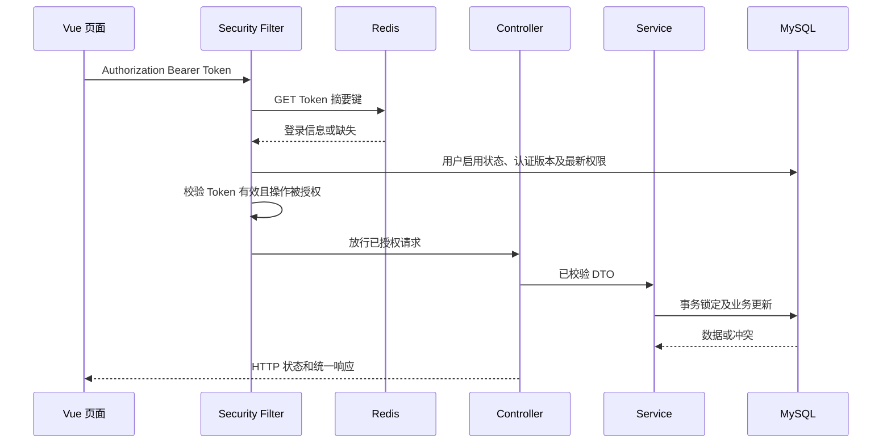

# 详细设计：基础后台 RBAC 管理

- 需求编号：XQ20261009-001
- 需求来源：[需求分析](../ai-devlop-spec/需求分析.md)
- 配套：[接口设计](接口设计.md)、[数据结构设计](数据结构设计.md)
- 设计性质：全新项目拟新增方案。工作区仅有技能及本需求文档，没有既有业务代码、构建文件或数据库结构。

## 1. 设计概述

### 1.1 实现目标与技术选择

实现用户、角色、预置权限、Redis 登录 Token、操作记录与登录日志的基础闭环，覆盖 S-001～S-010。不新增业务模块、部门、多租户、数据权限、用户删除或权限运行时 CRUD。

| 层次 | 本次拟采用 | 理由 |
|---|---|---|
| 后端 | Java 21、Spring Boot 3.5 系列、Spring Security 6.5 系列、Maven 3.9 | 使用 Boot 依赖管理，统一认证、校验及事务 |
| 数据访问 | Spring JDBC（JdbcClient / JdbcTemplate）、MySQL 8.4、Flyway | 本版 SQL 和关联查询简单，显式表达行锁及原子操作 |
| 前端 | Vue 3、TypeScript 5、Vite、Vue Router 4、Pinia、Element Plus 2 | 页面、路由和权限展示清晰分层 |
| 工具链 | Node.js 22、pnpm | 支持前端构建及依赖锁定 |
| 认证 | 随机 Bearer Token、Redis | 登录凭证不落数据库表；退出删除当前 Token，改密和停用通过认证版本撤销全部 Token |
| 部署 | 同源反向代理，/api 转发后端、其他路径返回前端 | 保持前后端分离实现，统一入口及 Bearer 请求来源 |
| 权限 | 每次请求查询数据库，无跨请求权限缓存 | 下一次请求使用最新授权，不依赖缓存失效通知 |

版本是设计基线，不宣称最新版本或已完成兼容性验证。实施时锁定系列内具体补丁版本并生成依赖锁文件；后端 Security 版本由 Boot BOM 管理，不手动跨系列混搭。官方文档检索在本次发生连接失败，未获得在线核验结果；实施需核对选定补丁的 Bearer 过滤器、Redis 客户端和数据库驱动/Flyway 支持，不改变已确认业务规则。

配置包含 datasource、auth.token-ttl、初始化管理员账号/密码、Redis 连接与日志等级。Token 寿命为必填正数配置；不硬编码业务有效期限。首次初始化密码从部署环境读取，禁止默认明文密码或日志打印；初始化管理员已存在时不再要求初始密码，也不覆盖其现有密码。所有新增文件均为拟新增，本文不包含业务代码或可执行迁移。

### 1.2 需求场景对应

| 场景编号 | 场景 | 实现入口 | 关联接口 | 关联数据结构 | 设计位置 |
|---|---|---|---|---|---|
| S-001 | 初始化管理基础 | BootstrapInitializer.run() | 不涉及 HTTP | [数据 §2.1](数据结构设计.md#21-sys_user)、[§2.3](数据结构设计.md#23-sys_permission) | §4.1 |
| S-002 | 登录与退出 | AuthController.login/logout/me | [接口 §2.2～2.4](接口设计.md#22-i-002-登录) | [数据 §2.1](数据结构设计.md#21-sys_user)、[§2.4](数据结构设计.md#24-sys_user_role)、[§2.5](数据结构设计.md#25-sys_role_permission)、[§3.1](数据结构设计.md#31-rbactokentokenhash)、[§3.2](数据结构设计.md#32-http-与前端-token) | §4.2 |
| S-003 | 修改本人密码 | AuthController.changePassword | [接口 §2.5](接口设计.md#25-i-005-修改本人密码) | [数据 §2.1](数据结构设计.md#21-sys_user)、[§3.1](数据结构设计.md#31-rbactokentokenhash) | §4.3 |
| S-004 | 管理用户资料 | UserController.list/create/detail/update | [接口 §2.6～2.9](接口设计.md#26-i-006-查询用户列表) | [数据 §2.1](数据结构设计.md#21-sys_user)、[§2.2](数据结构设计.md#22-sys_role)、[§2.4](数据结构设计.md#24-sys_user_role) | §4.4 |
| S-005 | 调整用户状态与重置密码 | UserController.changeStatus/resetPassword | [接口 §2.10](接口设计.md#210-i-010-调整用户状态)、[§2.11](接口设计.md#211-i-011-重置用户密码) | [数据 §2.1](数据结构设计.md#21-sys_user)、[§3.1](数据结构设计.md#31-rbactokentokenhash) | §4.5 |
| S-006 | 管理角色 | RoleController.list/create/detail/update/delete | [接口 §2.14～2.18](接口设计.md#214-i-014-查询角色列表) | [数据 §2.2](数据结构设计.md#22-sys_role)、[§2.3](数据结构设计.md#23-sys_permission)、[§2.4](数据结构设计.md#24-sys_user_role)、[§2.5](数据结构设计.md#25-sys_role_permission) | §4.6 |
| S-007 | 分配角色与权限 | UserController.roles/assignRoles、RoleController.permissions/assignPermissions、PermissionController.tree、RoleOptionController.list | [接口 §2.12](接口设计.md#212-i-012-查询用户角色集合)、[§2.13](接口设计.md#213-i-013-保存用户角色集合)、[§2.19～2.22](接口设计.md#219-i-019-查询预置权限树) | [数据 §2.1～2.5](数据结构设计.md#21-sys_user) | §4.7 |
| S-008 | 执行权限控制与变更生效 | TokenAuthenticationFilter、RbacAuthorizationManager、前端 router/权限指令 | [接口 §2.4](接口设计.md#24-i-004-查询当前身份与权限)、所有受保护接口 §2.3～2.26 | [数据 §2.1～2.5](数据结构设计.md#21-sys_user)、[§3.1](数据结构设计.md#31-rbactokentokenhash)、[§4.1](数据结构设计.md#41-permissioncontext仅当前请求内存) | §4.8 |
| S-009 | 记录与查看操作记录 | AuditCaptureFilter、OperationLogController.list/detail | [接口 §2.23](接口设计.md#223-i-023-查询操作记录列表)、[§2.24](接口设计.md#224-i-024-查询操作记录详情)；采集关联 I-005/I-007/I-009/I-010/I-011/I-013/I-015/I-017/I-018/I-021 | [数据 §2.6](数据结构设计.md#26-sys_operation_log)；身份只读关联 [§2.1](数据结构设计.md#21-sys_user) | §4.9 |
| S-010 | 记录与查看登录日志 | AuditCaptureFilter、AuthController.login、LoginLogController.list/detail | [接口 §2.2](接口设计.md#22-i-002-登录)、[§2.25](接口设计.md#225-i-025-查询登录日志列表)、[§2.26](接口设计.md#226-i-026-查询登录日志详情) | [数据 §2.7](数据结构设计.md#27-sys_login_log)；身份只读关联 [§2.1](数据结构设计.md#21-sys_user)，签发参考 [§3.1](数据结构设计.md#31-rbactokentokenhash) | §4.10 |

上表范围章节包含该范围全部接口/表；场景正文再明确每项关联用途，无范围外场景。

### 1.3 模块

| 模块 | 职责 | 变更 |
|---|---|---|
| system | 当前全部业务：Token认证、权限校验、登录退出/改密、用户资料/启停/重置/角色关联、角色/权限管理、初始化、两类日志采集/查询；模块内按controller/service/repository/dto/vo等职责分层 | 已实现；2026-10-10按用户要求统一模块 |
| common | 通用响应、错误处理、JSON配置与校验；系统业务枚举归system/enums | 已实现 |
| frontend | 登录、后台布局、用户管理、角色管理、改密、授权弹窗及两类日志页面 | 拟新增 |

## 2. 整体流程

Token 只从 Bearer Header 取得，Redis 保存登录信息，不保存权限快照。读取用户启用状态及 auth_version 与 Redis 签发时版本对照，权限再用 DISTINCT 关联查询即时计算。MySQL 更新密码或停用时原子递增 auth_version，即使 Redis 旧键未删除，也不能再使用旧 Token。

下一次请求的边界为：授权或认证版本变更事务提交后开始校验的请求必须看到新结果；提交前已经通过认证授权的在途请求可以按原判断完成。Redis 不可用时默认拒绝，不能回退到数据库会话表或旧身份缓存。

## 3. 模块设计

### 3.1 Controller 入口

方法与请求/响应契约严格对应[接口 §2](接口设计.md#2-接口详情)。请求参数表规定 Path/Query/Body DTO；返回为 ApiResponse<指定 data 类型>。

| Controller 方法 | 参数 | data 返回类型 | 职责 |
|---|---|---|---|
| AuthController.login(LoginRequest) | username、password | LoginData | 登录 |
| AuthController.logout() | 无业务参数 | null | 退出登录 |
| AuthController.me() | 无业务参数 | MeData | 查询当前身份与权限 |
| AuthController.changePassword(ChangePasswordRequest) | oldPassword、newPassword | null | 修改本人密码 |
| UserController.list(UserQuery) | page、size、keyword、status | UserPage | 查询用户列表 |
| UserController.create(CreateUserRequest) | username、displayName、password、phone、email | User | 新增用户 |
| UserController.detail(id) | id | User | 查询用户详情 |
| UserController.update(id,UpdateUserRequest) | id、version、displayName、phone、email | User | 编辑用户资料 |
| UserController.changeStatus(id,StatusRequest) | id、version、status | User | 调整用户状态 |
| UserController.resetPassword(id,ResetPasswordRequest) | id、version、newPassword | null | 重置用户密码 |
| UserController.roles(id) | id | UserRoles | 查询用户角色集合 |
| UserController.assignRoles(id,UserRolesRequest) | id、version、roleIds | UserRoles | 保存用户角色集合 |
| RoleController.list(RoleQuery) | page、size、keyword | RolePage | 查询角色列表 |
| RoleController.create(CreateRoleRequest) | name、description | Role | 新增角色 |
| RoleController.detail(id) | id | Role | 查询角色详情 |
| RoleController.update(id,UpdateRoleRequest) | id、version、name、description | Role | 编辑角色资料 |
| RoleController.delete(id,version) | id、version | null | 删除角色 |
| PermissionController.tree() | 无业务参数 | Array<PermissionNode> | 查询预置权限树 |
| RoleController.permissions(id) | id | RolePermissions | 查询角色权限集合 |
| RoleController.assignPermissions(id,RolePermissionsRequest) | id、version、permissionIds | RolePermissions | 保存角色权限集合 |
| RoleOptionController.list() | 无业务参数 | Array<RoleOption> | 查询角色分配选项 |
| OperationLogController.list(OperationLogQuery) | 分页、操作账号、类型、结果、起止时间 | OperationLogPage | 查询操作记录 |
| OperationLogController.detail(id) | 操作记录 ID | OperationLogDetail | 查看操作记录详情 |
| LoginLogController.list(LoginLogQuery) | 分页、尝试账号、结果、起止时间 | LoginLogPage | 查询登录日志 |
| LoginLogController.detail(id) | 登录日志 ID | LoginLogDetail | 查看登录日志详情 |

每个入口记录一条日志，例如 [用户管理] 编辑用户 operatorId={} userId={} version={}。登录入口记录 [认证] 登录 username={}，不序列化密码 DTO；日志参数清理 CR/LF 防止注入。登录响应中的 Token 以及 Authorization Header 均不记录。登录/校验结果、状态变更、密码修改、授权保存、角色删除在 Service 记录结果，失败日志含非敏感对象标识及错误码。过滤器拒绝发生在 Controller 前时在认证/授权层记录对应拒绝节点。

Controller 不抽取公共方法。Service 方法只承担列出的业务职责，不主动抽取本次重复代码；非 Controller 的额外公共方法抽取仅在用户给定的全部条件满足时允许（本次产生重复超过 50 行且至少 3 处使用）。

### 3.2 Service 与专职安全组件

| 类/方法 | 参数 → 返回 | 职责 |
|---|---|---|
| AuthService.login | LoginRequest → LoginData（含 Token） | 验证账号密码、锁定用户复核并保存 Redis Token |
| AuthService.logout | 当前 Token 认证上下文 → void | 删除 Redis 当前 Token 键 |
| AuthService.me | 当前认证上下文 → MeData | 组合本人资料、角色、最新权限与可见菜单 |
| AuthService.changePassword | 当前用户 ID、ChangePasswordRequest → void | 校验原密码，更新摘要并递增认证版本，撤销全部旧 Token |
| UserService.list/detail/create/update | 对应查询/请求 DTO → UserPage/User | 资料查询和修改 |
| UserService.changeStatus/resetPassword | 用户 ID、对应 DTO → User/void | 状态保护或密码重置并原子递增认证版本 |
| UserService.roles/assignRoles | 用户 ID、可选授权请求 → UserRoles | 读取或整体替换角色集合 |
| RoleService.list/detail/create/update/delete | 对应参数 → RolePage/Role/void | 角色资料及受限删除 |
| RoleService.permissions/assignPermissions | 角色 ID、可选授权请求 → RolePermissions | 权限集合读写 |
| PermissionService.tree | 无 → PermissionNode[] | 返回完整预置树 |
| RoleOptionService.list | 无 → RoleOption[] | 仅返回分配角色所需 ID/名称 |
| TokenAuthenticationFilter.doFilterInternal | HTTP 请求 → 认证上下文或错误 | 取 Bearer Header，Redis 摘要查询，校验期限、用户启用及认证版本 |
| RbacAuthorizationManager.check | 当前用户、所需权限 → 放行/拒绝 | 普通用户按代码匹配；超级管理员读取全部预置权限；未映射接口拒绝 |
| BootstrapInitializer.run | 已验证配置 → 无 | 启动时事务初始化 |
| AuditCaptureFilter.doFilterInternal | HTTP 请求、RequestAuditContext → 原响应不变 | 包裹 Security 和业务链路，统一捕获一次事件并调用独立保存 |
| AuditRecordWriter.saveOperation/saveLogin | 已脱敏事件 → void | REQUIRES_NEW 独立写入；异常由捕获层吞掉并告警，不改主业务结果 |
| OperationLogService.list/detail | 查询参数/ID → OperationLogPage/Detail | 全平台操作记录查询 |
| LoginLogService.list/detail | 查询参数/ID → LoginLogPage/Detail | 全平台登录日志查询 |
| RedisTokenStore.issue/find/revoke | 用户 ID/认证版本/原始 Token → Token 信息或删除结果 | SET NX PX、GET、DEL，不保存在数据库表 |

安全组件为明确的框架扩展职责，不是从 Controller 业务代码抽取的公共方法。使用 Spring Security SessionCreationPolicy.STATELESS（仅指不使用 Servlet HttpSession），认证实际依赖 Redis Token 和 MySQL 用户认证版本。SecurityContext 仅保留当前请求，禁用 formLogin/httpBasic 和默认表单重定向，错误统一 JSON。

权限校验行为：正常请求从 sys_user_role JOIN sys_role_permission JOIN sys_permission 读取 DISTINCT code；超级管理员从 sys_permission 获取全部预置代码，用户状态/Token 校验不可绕过。模块方法必须有注释，重要保护和并发分支加简洁注释，实体与 DTO 每个字段都有 Javadoc 注释。

### 3.3 Repository

所有 Repository 为拟新增、使用参数化 SQL，列表关键词转义 LIKE 通配符。

| 类 | 关键方法 | 返回/用途 |
|---|---|---|
| UserRepository | findByUsername、findById、lockById、insert、updateProfile、updateStatus、updatePassword、page | User 记录、受影响行数、列表；版本条件更新 |
| RoleRepository | findById、lockByIds、insert、update、delete、page、options | 角色记录、锁定有效角色、受影响行数 |
| PermissionRepository | listOrdered、findByIds、effectiveCodes | 预置权限列表和有效权限集合 |
| UserRoleRepository | findRolesByUser、existsByRole、replace | 用户角色读取、删除校验、整体替换 |
| RolePermissionRepository | findByRole、replace、deleteByRole | 角色权限读写 |
| OperationLogRepository | insert、page、findById | 操作记录独立写入与只读查询 |
| LoginLogRepository | insert、page、findById | 登录日志独立写入与只读查询 |

replace 方法在调用方事务内运行，不能自开事务独立提交。Token 信息由 RedisTokenStore 管理而非 Repository；列表及详情用明确列映射为 DTO，不返回密码摘要或 auth_version。用户密码/状态更新同时处理认证版本，不能靠 Redis DEL 代替版本判断。

### 3.4 前端模块

| 模块 | 职责 |
|---|---|
| api/http.ts | 从 sessionStorage 读取 Token，注入 Authorization Bearer Header，处理统一错误，禁止自动重试写请求 |
| stores/auth.ts | 当前 User、permissionCodes、menus 和 Token；Token 在 sessionStorage，重载后调用 me 重建 |
| router/index.ts | 登录、空后台首页、改密、/system/users、/system/roles、/audit/operations、/audit/logins；管理和日志页按对应 query 权限守卫 |
| directives/permission.ts | 按操作代码显示/隐藏按钮，不提供后端授权依据 |
| views/LoginView.vue | 用户名密码登录，成功后保存 Token、调用 me 并进入后台 |
| layouts/AdminLayout.vue | 可见菜单、本人信息、改密、退出；无权限用户可看到基本布局 |
| views/UserView.vue | 资料列表与详情、新增/编辑、状态调整、重置、角色分配 |
| views/RoleView.vue | 角色列表与详情、新增/编辑/删除、权限分配 |
| components/UserRoleDialog.vue | 当前 roleIds、版本及角色选项；整体保存 |
| components/RolePermissionDialog.vue | 当前 permissionIds、版本与完整预置树；不级联自动授权 |
| views/OperationLogView.vue | 独立 operation-log:query 权限；账号、操作类型、结果、时间筛选，分页及详情弹窗 |
| views/LoginLogView.vue | 独立 login-log:query 权限；尝试账号、结果、时间筛选，分页及详情弹窗 |

登录名编辑时展示只读，接口 DTO 同时拒绝修改。手机号邮箱选填、重复允许；前后端格式规则一致。前端后台首页只提供身份及导航提示，不新增业务看板。

每次进入后台路由前、窗口重新获得焦点、业务请求成功或 403 后刷新 me；刷新可合并同一时刻的并发 GET，但不得跨请求缓存后端权限。授予权限后这些刷新点更新菜单；撤销权限后拒绝请求刷新并离开失去访问权的页面。不宣称通过推送让静止页面在后台变更瞬间更新。401 清除 Token 和身份并跳转登录；改密/自身重置成功立即结束当前前端状态；50301 停止受保护请求并提示认证服务不可用，不自动重试写请求。me 失败默认停止受保护导航，不沿用旧身份展示可操作页面。

### 3.5 操作记录与登录日志采集

持久化记录与 §5.4 运行日志分别实现，不能从文本运行日志反解析出业务历史。AuditCaptureFilter 在 Spring Security 之前运行，提前建立服务端 UUID、到达时间、安全来源 IP/UA 及请求模板，仅处理明确的事件映射；在 finally 中按主流程最终结果保存一次。Controller 不抽取公共方法，记录器为专职组件，不把每个业务方法重写为通用 CRUD。

| 请求 | 类型/模块 | 记录 |
|---|---|---|
| POST /api/users、POST /api/roles | 0 新增；user/role | 操作记录 |
| PUT /api/users/{id}、PUT /api/roles/{id} | 1 编辑；user/role | 操作记录 |
| PUT /api/users/{id}/status | 2 启停；user | 操作记录 |
| DELETE /api/roles/{id} | 3 删除；role | 操作记录 |
| PUT /api/auth/password | 4 本人改密；auth | 操作记录 |
| PUT /api/users/{id}/password | 5 重置密码；user | 操作记录 |
| PUT /api/users/{id}/roles | 6 分配角色；user | 操作记录 |
| PUT /api/roles/{id}/permissions | 7 分配权限；role | 操作记录 |
| POST /api/auth/login | 登录尝试 | 只写登录日志 |
| 所有普通 GET、日志查询、me、角色/权限选项 | 查询 | 不采集操作记录 |
| POST /api/auth/logout、初始化任务 | 不属于本次确认的记录范围 | 保留运行日志，不写上述两类记录 |

RequestAuditContext 仅当前请求使用，字段包括 requestId、事件映射、真实认证用户快照、安全 DTO 白名单、目标 ID、主流程耗时、事务提交结果及安全错误码。TokenAuthenticationFilter 在认证成功时立即复制操作人快照到请求上下文（早于 SecurityContext 清理），AuthService 在可识别登录账号时补充 userId；Security handlers/ControllerAdvice 向上下文写最终错误码；未通过认证的操作 operatorId/username/displayName 为 NULL，不依据客户端填值伪造身份。发生在 Security 层的 401/403/503、MVC 参数校验失败、Service 业务错误与数据库回滚均可记录，不能只用 Controller AOP 捕获而遗漏提前拒绝。

Spring RequestBodyAdvice 只对映射事件的已反序列化 DTO 提取白名单字段，在 MVC 校验前供失败记录使用；不缓存原始请求 Body，不序列化整个 DTO。登录 DTO 只提取格式/容量合法的 username，密码绝不入上下文；JSON 无法解析、未知字段或账号非法时账号可为空。新增目标 ID 由已提交的创建结果提供；编辑/授权仅保留有效的目标路径 ID。summary 安全字段在[数据 §2.6](数据结构设计.md#26-sys_operation_log)集中维护。

成功操作依业务真实提交结果判断：数据库事务 afterCommit 标记成功，回滚不能被标记成功；事务已提交但响应发送失败，记录提交成功，不谎称回滚。登录只有 Redis 签发及用户事务完成才标记成功，Token 不在记录上下文中保存。安全失败原因使用标准错误文案，不记录异常原文；未映射内部异常 50000，无法解析参数 40001。单次请求统一保存一次，request_id 唯一键防止重复拦截写两行；失败重试是新请求，生成新标识。

前端摘要与 UA/失败说明全部用文本转义显示，不用 v-html。只从可信代理地址解析来源链，未配置可信代理时使用连接远端 IP，禁止任意 X-Forwarded-For 伪造。X-Request-Id Header 返回请求 UUID；不会新增 URL 中的凭据。

## 4. 场景实现设计

### 4.1 S-001 初始化管理基础

实现位置：BootstrapInitializer.run、UserRepository、PermissionRepository；无管理 HTTP 接口。

处理：
1. Flyway 创建 §2 所列数据结构、约束及索引；初始化入口验证预置权限定义无环、代码唯一且覆盖全部接口映射。
2. 权限按 code 唯一键幂等插入，先父后子；首次初始化管理员从环境取得账号及密码，经 BCrypt 后存入，status=1、is_super_admin=1。
3. MySQL 同一连接获取命名初始化锁，串行化多实例；事务中先查询任意超级管理员，存在则复用，不创建第二个或覆盖密码。锁获取失败或事务失败则启动失败；连接 finally 释放命名锁。
4. 只补充缺少预置项，不重置已有角色授权；初始化完成记录数量与结果，不打印密码。

| 需求异常/边界 | 判断位置与处理 |
|---|---|
| 重复初始化 | 唯一 code/username 和串行初始化，不覆盖现有密码和授权 |
| 初始化失败 | 事务回滚，阻止就绪，不宣称可用 |
| 停用或删除超级管理员 | 无用户删除入口；状态 Service 与 CHECK 拒绝停用 |
| 普通角色授权变化 | 超级管理员授权路径不依赖关联角色 |

验收对应：拟验证首次启动账号能管理全部功能、权限选项完整；重复启动后密码和角色权限保持，失败配置不能进入就绪。

### 4.2 S-002 登录与退出

实现位置：AuthController I-002～I-004、AuthService、TokenAuthenticationFilter、RedisTokenStore。

处理：
1. 登录请求用大小写敏感账号查询，账号不存在或密码错误统一 40102；不存在时执行 dummy BCrypt 校验，不记录密码。
2. 密码验证后事务锁用户，复核密码摘要、启用状态和 auth_version；期间密码变化重新校验，停用返回 40302。锁与改密、重置、停用共用用户行。
3. 生成安全随机 Token，Redis SET 摘要键 NX PX 写入签发用户及认证版本，Redis 必须明确返回成功。用户事务完成后才向客户端返回 Token、tokenType=Bearer、expiresAt 及 user；响应前不把原始 Token 写日志或其他可见通道。
4. 前端保存到 sessionStorage，后续附加 Bearer Header；me 返回最新权限，无角色则为空数组，仍可本人改密和退出。再次登录产生独立 Token，不主动撤销其他登录。
5. 退出使用 Redis DEL 当前 Token 键，确认删除后前端清除 Token；旧 Token 再请求 40101。退出只撤销当前 Token，不撤销其他浏览器。

| 需求异常/边界 | 判断位置与处理 |
|---|---|
| 必填缺失 | DTO 40001 |
| 账号不存在/密码错误 | AuthService 统一 40102 |
| 停用登录 | 凭据正确后返回 40302，不签发 Token |
| 缺失、过期、撤销或认证版本不符 | Filter 40101，不进入业务层 |
| 无权限 | me 空权限，仅本人功能 |
| 退出后旧 Token 重放 | Redis 键缺失，40101 |
| Redis SET/GET/DEL 失败或超时 | 50301，不放行、不宣称登录/退出成功 |
| Redis 成功但数据库事务/响应失败 | §5.1 补偿删除；原始 Token 不对外返回，孤立键按 TTL 清理 |

验收对应：拟验证正确登录返回 Token、权限菜单一致、退出后同一 Token 被拒绝，其他 Token 不受退出影响；Redis 故障时不能登录或操作；无角色用户不能进入管理接口。

### 4.3 S-003 修改本人密码

实现位置：AuthController.changePassword（I-005）、AuthService.changePassword、UserRepository。

处理：身份固定为当前认证用户，不接收 userId；锁用户并确认启用，验证原密码后更新 BCrypt 摘要、version/updated_at，同时 auth_version 加一，同一 MySQL 事务提交。提交后所有 Redis 旧 Token 的版本均不匹配，立即拒绝；不遍历/删除 Redis，旧键 TTL 到期自动清理。前端清除 Token、回登录，不自动签发新 Token。

| 需求异常/边界 | 判断位置与处理 |
|---|---|
| 原密码错误 | 40002，密码与认证版本不变 |
| 必填/格式非法 | 40001，禁止截断密码 |
| 指定他人 ID 或未知字段 | DTO 白名单 40001 |
| 更新失败 | 同一事务回滚密码、资料修订号及认证版本，旧 Token 保持原有效性 |
| Redis 不可用 | 入口认证 50301；已经通过认证的在途改密仍以数据库提交结果为准，不依赖 Redis 清理 |

验收对应：拟使用两个独立 Token 登录，改密后均 40101，新密码可登录、旧密码 40102；模拟数据库失败则旧密码及认证版本保持，Redis 恢复后旧 Token 未因失败改密被误撤销。

### 4.4 S-004 管理用户资料

实现位置：UserController I-006～I-009、UserService、UserRepository、UserRoleRepository/RoleRepository（只读角色资料）。

处理：查询权限固定 user:query；新增权限 user:create，只接收账号、显示名、密码、联系方式，强制默认启用、普通用户、无角色。资料编辑仅 displayName/phone/email，锁定用户、比较 version 后更新。username 区分大小写唯一，由二进制排序规则及唯一键兜底。资料和查询返回关联角色简要信息，不需要授权操作权限才能查看。

| 需求异常/边界 | 判断位置与处理 |
|---|---|
| 重复或并发重复账号 | 唯一键 40901；Admin 与 admin 可分别存在 |
| 必填缺失/非法/超存储容量 | DTO 40001，不保存 |
| 目标不存在 | 40401，先鉴权 |
| 空查询 | items=[]、total=0 |
| 保存失败 | 事务回滚 50000 |
| 修改账号 | 不在 DTO 白名单，40001，不修改 |
| 联系资料为空 | 归一 NULL，允许 |
| 联系资料格式无效 | 40001，显示对应字段规则 |
| 联系资料重复 | 不判重、不建唯一键，允许 |
| 用户删除 | 无 API、无按钮，未知路径默认拒绝 |
| 并发编辑 | 修订号过期 40902，禁止静默覆盖 |

验收对应：拟验证新增可查、资料编辑持久化、摘要绝不返回；大小写不同账号可以创建；两用户相同联系资料允许保存，空联系方式允许保存。

### 4.5 S-005 调整用户状态与重置密码

实现位置：UserController I-010/I-011、UserService.changeStatus/resetPassword、UserRepository。

状态调整：校验 user:status，锁定目标用户；超级管理员不可停用。相同状态直接返回不递增修订号。启用转为停用时校验 version，同时更新 status、version、auth_version，单个数据库事务提交；保留用户角色关联。启用不降低认证版本，不恢复停用前 Token，必须重新登录。

重置密码：校验 user:reset-password，锁用户并校验 version，更新密码摘要、version、auth_version，同一事务提交。全部旧 Token 版本不符，无需 Redis 批量删除。停用用户可重置，但仍须启用后才能登录。

| 需求异常/边界 | 判断位置与处理 |
|---|---|
| 用户不存在 | 40401 |
| 重复状态操作 | 相同状态成功、版本不变 |
| 超级管理员停用 | 40904，数据库 CHECK 同时保护 |
| 停用时已有登录 | 状态及认证版本提交后下一次请求 40101 |
| 密码非法/资料版本过期 | 40001/40902，不改密、不更改认证版本 |
| 保存失败 | 同一事务回滚状态、密码及两类版本 |
| 操作目标为当前用户 | 成功后本人也需清除 Token 并重新登录 |
| Redis 不可用 | 新操作认证 50301；数据库已提交的撤销不依赖 Redis，恢复后旧 Token 仍无效 |

验收对应：拟验证停用阻断旧 Token 及新登录，重新启用不恢复旧 Token；重置使全部旧 Token 失效，新密码可登录、旧密码失败；数据库失败时认证版本保持。

### 4.6 S-006 管理角色

实现位置：RoleController I-014～I-018、RoleService、RoleRepository、UserRoleRepository、RolePermissionRepository。

处理：查询/新增/编辑/删除分别校验其权限；新增空权限角色；名称唯一由数据库约束保证；编辑只改资料，版本检查。删除按 §5 行锁策略锁定角色，版本符合且不存在任何 sys_user_role 后删除角色权限，再删除角色，事务提交后不再作为选项返回。

| 需求异常/边界 | 判断位置与处理 |
|---|---|
| 角色不存在 | 40401（重复删除同样） |
| 无效资料或名称重复 | 40001/40901，不保存 |
| 仍有关联，包括停用用户 | existsByRole 不过滤状态，40903 |
| 删除与分配角色并发 | 两操作锁同一角色行；外键 RESTRICT 最终保护 |
| 部分删除失败 | 事务回滚角色及权限关联 |
| 并发编辑/授权 | version 不匹配 40902 |

验收对应：拟验证角色新增/编辑后资料可查、权限摘要可查、无用户关联角色删除后列表/选项消失；并发分配和删除不得形成悬空关联。

### 4.7 S-007 分配角色与权限

实现位置：UserController I-012/I-013、RoleController I-020/I-021、PermissionController I-019、RoleOptionController I-022。

用户角色：授权操作权限 user:assign-role；读取当前集合与版本，通过专用 role-options 获取 id/name，不额外要求 role:query。保存先锁用户并比版本，再升序锁定旧集合与目标集合中的全部角色，验证目标全部存在；原集合整体替换，清空允许，重复 ID 去重。修订号变化事务提交。

角色权限：权限 role:assign-permission；读取完整预置树与现有授权。锁角色、比版本，验证全部权限存在、去重后替换关联，清空允许。不自动给父子节点授权，同集合无变更时不递增 version；超级管理员始终保有全部功能。

| 需求异常/边界 | 判断位置与处理 |
|---|---|
| 用户/角色/权限不存在 | 40401，整次保存回滚 |
| 同一 ID 重复选择 | Service 去重，联合主键兜底 |
| 清空集合 | 正常撤销，无授权请求默认拒绝 |
| 保存失败 | 原完整集合保持，不部分提交 |
| 多角色同权限 | effectiveCodes DISTINCT，仅一个代码 |
| 移除一个重叠角色 | 另一个角色仍授权则权限保留 |
| 并发替换/编辑 | 锁加 version，过期请求 40902 |
| 分配角色期间角色被删除 | 锁串行化；已删除目标 40401，不写悬空关系 |

验收对应：拟验证双角色权限并集、授权查询与保存一致、移除重叠权限角色仍可操作、空集合撤权及无效 ID 全量回滚；授权更改生效复用 S-008。

### 4.8 S-008 执行权限控制与变更生效

实现位置：Filter、AuthorizationManager、AuthService.me、router、permission 指令；关联所有受保护 API。

流程与共用行为引用 §2、§3.2。请求身份只从 Redis Token 信息取得，不信任客户端角色、权限或超级管理员标志；接口权限固定映射[数据 §2.3](数据结构设计.md#23-sys_permission)。普通用户权限查询失败默认拒绝。页面 query 权限与操作权限分别检查；没有 query 权限不能进入相应页面，不自动通过子权限获取父页面权限。

| 需求异常/边界 | 判断位置与处理 |
|---|---|
| 输入未授权页面地址 | 路由守卫刷新 me 后拒绝，显示无权限页 |
| 直接请求未授权操作 | 后端 40301，数据不改变 |
| 只有查询权限 | 查询允许；写接口独立权限拒绝 |
| 已打开页面后撤权 | 后端下一次请求 40301；前端刷新 me、按钮/菜单同步并离开受限页面 |
| 账号停用/退出/改密 | Token 缺失或认证版本不符，下次认证 40101，不进入业务层 |
| 权限读取异常 | 50000，不使用缓存放行 |
| Redis 不可用 | 50301，不能凭历史身份放行 |
| 未声明的 HTTP 入口 | denyAll，不匹配角色就开放 |
| 超级管理员 | 权限允许，但 Token、参数及账号保护仍执行 |

验收对应：拟以不同授权账号检查菜单/页面/按钮差异，并直接请求越权 API；在两个浏览器间修改权限，分别验证撤权和授予后下一次请求立即按最新授权判断；验证 me 和后端有效权限一致。

### 4.9 S-009 记录与查看操作记录

实现位置：§3.5 AuditCaptureFilter、AuditRecordWriter、OperationLogRepository/Service/Controller。采集映射与白名单引用 §3.5 和数据 §2.6，不重复实现。

处理：
1. 映射关键写请求，提前获取安全上下文并执行原认证、授权与业务流程；验证失败也按失败采集。
2. 主流程完成后确定真实事务结果，按 §5.5 独立保存记录。保存失败不改变原响应或回滚业务。
3. I-023/I-024 校验 operation-log:query；列表筛选操作账号（大小写敏感精确）、类型、结果及 occurredAt 时间范围，固定 occurredAt DESC、id DESC。
4. 详情只读取记录快照，不 JOIN 当前用户/角色强制要求其仍存在；不把 password、Token、手机号/邮箱原值输出。

| 需求异常/边界 | 判断位置与处理 |
|---|---|
| 未登录/无查看权 | Security 40101/40301，独立权限，查询不形成新记录 |
| 业务失败/回滚 | 记录器保留失败码与安全标准说明，不记录成功 |
| 日志保存失败 | 捕获层 ERROR 告警，不改业务结果 |
| 空列表/详情不存在 | items=[]/40401 |
| 非法筛选/反向时间 | DTO 40001，[startTime,endTime) |
| 删除目标/资料变更 | 逻辑引用与操作人快照保留历史 |
| 普通 GET/日志查询 | 不在事件映射，不递归 |
| 修改、清空、删除、导出记录 | 无接口/按钮，未知入口默认拒绝 |
| 密码/Token/联系资料输入 | 白名单与安全字段标记，不原样记录 |

验收对应：拟验证十个写接口的成功、校验错误、越权、冲突及回滚记录正确；仅日志查询权者可分页及详情，只有 user:query 的账号被拒绝；注入记录存储错误时业务结果保持、运行错误和告警产生；历史记录不因角色删除消失。

### 4.10 S-010 记录与查看登录日志

实现位置：AuditCaptureFilter 登录映射、AuthService.login 上下文、AuditRecordWriter、LoginLogRepository/Service/Controller。

处理：
1. 每次 POST /api/auth/login 到达应用采集请求标识、可识别尝试账号和来源信息；参数/解析失败保留 NULL 账号，不保存请求正文。
2. 原登录凭据、状态、Redis 与事务结果决定 result；对外账号不存在/密码错误仍 40102，不通过日志改变公开认证行为。
3. 主流程结束按 §5.5 保存，成功登录不能因日志失败拒绝或撤销 Token；原失败不改为成功。
4. I-025/I-026 使用 login-log:query，按尝试账号、结果、时间筛选和分页，详情提供安全失败原因及来源。

| 需求异常/边界 | 判断位置与处理 |
|---|---|
| 未知账号/密码错误 | 统一错误，登录失败记录；未知 userId=NULL |
| 停用/参数无效/Redis 或数据库故障 | 保留相应实际失败码，服务整体不可用可能无法入库 |
| 已生成 Token 但主流程失败 | 上下文最终提交状态为失败，不凭曾生成过 Token 判成功 |
| 日志入库失败 | ERROR 与告警，登录结果及 Token 状态不变 |
| 无权限/无登录 | 40301/40101，不能读取日志 |
| 空结果/不存在/非法筛选 | []/40401/40001 |
| 请求没到应用 | 不保证记录，不伪造历史 |
| 查询、退出、改密、查询日志 | 不作为登录尝试；改密由操作记录承接 |
| 试图改删/清空/导出 | 无入口，不执行 |

验收对应：拟覆盖成功登录、错误密码、未知账号、停用、非法请求、Redis 故障的历史记录；具备独立权限才可查看，操作记录权限不能代替；记录存储失败且认证正常时仍登录成功，运行错误及告警可定位 requestId。

## 5. 事务、并发与异常

### 5.1 数据库事务与 Redis 边界

| 操作 | 数据库事务范围 | Redis 操作 | 成功条件 |
|---|---|---|---|
| 初始化 | 缺少权限插入、首次管理员插入 | 无 | 全部有效，否则启动失败 |
| 登录 | 用户行锁、复核密码/启用/认证版本 | 锁内 SET NX PX | Redis 写成功且用户事务完成后才返回 Token |
| 本人改密/管理员重置 | 密码、version、auth_version 原子更新 | 不批量删除 Token | 数据库提交，全部旧 Token 立即版本失配 |
| 用户停用 | status、version、auth_version 原子更新 | 不批量删除 Token | 提交后启用状态与认证版本阻断旧 Token |
| 新增/编辑用户、角色 | 资料、版本及时间更新 | 无 | 校验、唯一约束与版本满足 |
| 用户角色替换 | 锁用户/角色、替换关联、用户 version 递增 | 无 | 全部目标存在，版本符合 |
| 角色权限替换 | 锁角色、替换关联、角色 version 递增 | 无 | 全部目标存在，版本符合 |
| 删除角色 | 锁角色、检查用户关联、删除权限关联和角色 | 无 | 无关联且版本符合 |
| 退出 | 无数据库写入 | DEL 当前摘要键 | Redis 明确完成，当前 Token 无效 |

数据库事务不能回滚 Redis。登录 Redis 成功后若 MySQL 事务失败，在失败路径补偿 DEL 签发键；DEL 也失败则记录不含 Token 的补偿失败日志，原始 Token 不对外返回，孤立键依靠 TTL 清理。SET 超时可能已写入，同样按失败处理并尽力 DEL，不返回 Token。Redis SET 成功但响应丢失，客户端未取得新 Token，按 TTL 回收；不自动重试登录。

密码与状态撤销全部 Token 的正确性以 auth_version 为准，不以 Redis 清理成功为前提，因此数据库失败会同时回滚密码/状态及认证版本；数据库提交后无论 Redis 是否清理或重启，旧版本 Token 都被拒绝。Redis 退出失败不能宣称服务端撤销；前端提示认证服务不可用，不自动重放。

事务外发送响应失败不回滚已提交数据，客户端恢复依赖后先查结果。普通日志不是提交证据，完成日志放在提交后的同步回调。只读列表/详情使用一致快照读取主表和关联；认证/授权每次请求读取新已提交数据，不复用上一次请求的快照。

Redis 在网络分区或恢复旧备份时不得启用陈旧认证副本读取；认证主节点不可用默认拒绝。运维恢复必须清空认证命名空间后再开放服务，避免退出删除被旧快照恢复。此为运行约束，不引入数据库 Token 表或跨数据库/Redis 分布式事务。

### 5.2 并发

- 资料修订号与认证版本用途分开：用户 version 用于编辑冲突；auth_version 仅在改密、重置、启用转停用时递增。编辑资料、角色分配、角色授权不使 Token 失效，而在下一次请求重新计算权限。
- 用户资料、密码、状态、角色集合共用用户行锁；角色资料、权限集合及删除共用角色行锁。顺序先用户（若涉及），后角色 id ASC；角色删除不反向锁用户，角色分配锁旧集合与新集合并集。
- 登录在同一用户行锁内复核当前密码和认证版本后写 Redis；改密/停用与其串行化。登录先完成则后续变更认证版本使 Token 失效；变更先完成则旧密码/停用用户不能新签发 Token。
- 本人改密不接收 version，靠用户行锁和原密码校验；其他资料、状态不同值、重置、授权写操作使用请求 version，锁后比对并条件更新，过期 40902。
- 授权与角色删除同锁角色，结合 RESTRICT 外键不产生悬空关联。死锁、锁超时回滚返回 40902；不自动重试业务写操作。
- Redis Token 碰撞用 NX 检测后重新生成随机值，不覆盖；退出 DEL 原子，不创建角色权限缓存、Redis 锁或用户 Token 集合。

### 5.3 重复请求

初始化幂等不覆盖；相同启停状态保持且不递增认证版本。授权集合去重，版本匹配且集合相同不递增 version。新增以唯一字段判重，重复删除 40401，旧 version 重放 40902。退出后旧 Token 请求 40101；Redis DEL 返回 0 且本请求此前已认证，视为已撤销成功。无通用幂等中间件，不自动重试超时写请求。

### 5.4 异常与日志

错误统一见[接口 §3.2](接口设计.md#32-错误码)。认证/授权由 Security handlers 返回相同 JSON 包装，业务/参数异常由 ControllerAdvice 处理。Redis 异常 50301，数据库/未知异常 50000，缺失/过期/认证版本不符 40101；均不展示堆栈或内部键值。

每个 Controller 入口记录 [模块] 功能点 关键非敏感参数；记录登录结果、密码/认证版本更新、启停前后、当前 Token 撤销结果、角色删除保护及授权变更数量。日志不得包含 Token、摘要、Authorization、密码、完整手机号或邮箱。Token 写入和撤销的阶段日志只用用户 ID、成功与否和错误码，不记录原始 Redis key。初始化、较长授权链路保留校验/保存阶段日志，两类持久化日志与运行日志职责分开。

### 5.5 操作记录与登录日志保存策略

- 记录器在原业务链路及事务结束后执行同步 best-effort 保存，独立 Spring Bean 的 REQUIRES_NEW 新事务，只涉及对应日志表 INSERT。不加入用户/角色/密码业务事务，失败不会将原事务标记回滚；不要用同类方法自调用导致传播规则失效。
- 原业务提交成功才写 result=1，回滚、校验、认证/授权拒绝则写 result=0。AuditCaptureFilter 无论保存是否成功都返回原业务结果，保存异常在边界捕获，不覆盖原异常或 response。
- 保存超时/异常记录结构化 ERROR 事件 AUDIT_WRITE_FAILED，包括 logType、requestId、非敏感用户/目标 ID、标准原因，不包含原始 Token、摘要或敏感 DTO。部署告警规则接收该错误事件；本版不增加通知发送接口或具体第三方通知渠道。若告警设施也不可用，至少保留本地运行错误，不能承诺已送达通知。
- 日志写数据库可能延长响应等待；配置独立短连接/语句超时，不能无限等待。当前不引入 MQ、异步队列、补偿任务或可靠 outbox；原业务已成功但日志失败、进程崩溃或请求未到达时允许缺失，不提供“零丢失”保证。
- 日志查询仍以正常数据库读失败返回 50000，不能把查询失败包装为空列表。事件记录失败和事件查询失败含义不同。
- 日志不存在更新、删除、导出、自动清理入口，历史只追加。不保存完整请求/响应、密码摘要、认证版本或联系方式原值；字段、索引及固定整数编码见数据 §2.6/§2.7。
- 日志查询的 items 与 total 在同一只读事务快照中读取，筛选参数统一转换到 UTC；起止两端存在时 endTime 必须大于 startTime。来源 IP 仅信任部署配置代理，不擅自采信请求头。

## 6. 代码变更

包根为 com.muqiu.managentcenter。2026-10-10 按用户要求将当前业务统一为 system 模块，模块内按职责分层；以下目录与实际实现同步。

| 拟新增位置 | 用途 |
|---|---|
| backend/pom.xml | Boot、Security、Validation、JDBC、MySQL、Flyway、Spring Data Redis 依赖与 Java 21 构建 |
| backend/src/main/java/com/muqiu/managentcenter/ManagentCenterApplication.java | 后端启动 |
| backend/src/main/java/com/muqiu/managentcenter/system/controller/ | 系统管理的全部 Controller：认证、用户、角色、权限、两类日志 |
| backend/src/main/java/com/muqiu/managentcenter/system/service/ | 对应业务 Service 及独立事务 AuditRecordWriter |
| backend/src/main/java/com/muqiu/managentcenter/system/repository/ | User、Role、Permission、OperationLog、LoginLog 的数据访问 |
| backend/src/main/java/com/muqiu/managentcenter/system/dto/ | 请求参数白名单与校验 |
| backend/src/main/java/com/muqiu/managentcenter/system/vo/ | 接口返回资料、权限树和日志视图 |
| backend/src/main/java/com/muqiu/managentcenter/system/entity/ | 内部 UserAccount、PermissionRow |
| backend/src/main/java/com/muqiu/managentcenter/system/enums/、constants/ | 系统业务整数枚举及预置权限定义 |
| backend/src/main/java/com/muqiu/managentcenter/system/config/、security/ | 配置、安全链、认证过滤、权限判断和Redis凭据存储 |
| backend/src/main/java/com/muqiu/managentcenter/system/init/ | BootstrapInitializer |
| backend/src/main/java/com/muqiu/managentcenter/system/audit/ | AuditCaptureFilter、RequestAuditContext、BodyAdvice、AuditOutcome |
| backend/src/main/java/com/muqiu/managentcenter/common/ | ApiResponse、错误处理、JSON配置与通用校验 |
| backend/src/main/resources/db/migration/ | 7 张业务/日志表、认证版本字段、约束、索引和权限种子迁移，不建登录会话表 |
| backend/src/main/resources/application.yml | 配置键声明，密码、数据库及 Redis 连接凭据从环境读取 |
| frontend/package.json、frontend/pnpm-lock.yaml、frontend/vite.config.ts | Vue 工程、依赖锁、开发 /api 代理 |
| frontend/src/api/、stores/、router/、directives/ | API、身份状态、路由、权限指令 |
| frontend/src/views/、layouts/、components/ | §3.4 中列出的页面、授权组件及操作记录/登录日志列表与详情 |
| backend/src/test/ | Token 撤销、权限判断、事务回滚、并发关联及日志采集/故障不阻断验证 |
| frontend/src/**/*.spec.ts | 组件权限展示、改密后清状态、日志筛选/详情、独立权限与路由拒绝等组件测试 |
| deploy/ | 同源代理、Redis、可信代理及 AUDIT_WRITE_FAILED 告警规则示例，不含真实凭据 |

修改/删除既有业务代码：不涉及。此阶段不创建这些代码文件、不执行迁移或部署。

拟验证方式：后端服务和 Security 集成测试覆盖 S-001～S-010，关键并发及数据库约束采用真实 MySQL 测试环境，Token TTL/撤销/故障拒绝使用真实 Redis 测试环境；前端组件测试、类型检查和构建验证展示与接口 DTO 对应。不运行端到端测试，不新增性能指标。本文件的验收对应只描述后续应如何验证，不表示业务测试已通过。
