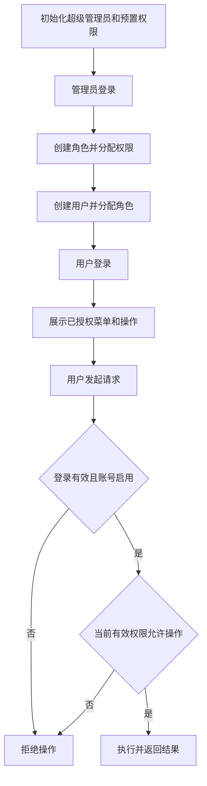

# 需求分析：基础后台 RBAC 管理

- 需求编号：XQ20261009-001
- 日期：2026-10-09
- 技能：ai-devlop-spec
- 原始输入：../原始需求/
- 规则来源：本次用户描述，以及此前同类需求中用户“按推荐方案”确认的基础 RBAC 范围（2026-10-09）。

## 1. 需求理解

### 1.1 需求目标

建立一个可登录、可管理用户与角色、可验证权限差异的后台网站基础版本，为后续业务模块提供权限控制基础。

- 使用对象：超级管理员、获得相应管理权限的后台用户、普通后台用户。
- 最终结果：管理员创建账号并分配角色，用户登录后只能查看、进入和操作其被授权的功能；后端独立校验权限。
- 已确认技术约束：前后端分离；后端采用 Java 21、Spring Boot、Spring Security，数据库采用 MySQL 8.4；前端采用 Vue 3、TypeScript、Element Plus；引入 Redis 保存 Token 登录信息，客户端使用 Token 作为登录凭证，不使用数据库登录会话表。用户、角色和权限业务数据仍存储于 MySQL；框架具体版本、Token 实现细节与部署方式由后续设计确定。

### 1.2 功能范围

本次包含：

- 账号密码登录、退出登录、修改本人密码。
- 用户查询、新增、编辑、启用、停用、重置密码及分配角色。
- 角色查询、新增、编辑、删除及分配权限。
- 菜单可见性、页面访问、操作按钮与后端请求权限控制。
- 初始化超级管理员与预置权限项。
- 授权变更及时生效、停用账号阻断已有登录的后续操作。
- 操作记录与登录日志的采集、分页查询、筛选和详情查看，分别受独立权限控制。

本次不包含：

- 具体业务模块、自助注册、用户删除。
- 部门、组织、多租户、数据权限、审批与第三方登录。
- 权限项的运行时新增、编辑、删除管理功能。
- 操作记录、登录日志的导出、删除、清空功能。

### 1.3 核心规则

1. 账号由具备用户新增权限的管理员创建，不开放自助注册。
2. 用户可关联多个角色，有效权限为所关联角色权限的并集；没有授权则默认拒绝。
3. 查询、创建、编辑、状态调整、重置密码、分配角色和分配权限均必须受相应权限控制，不能仅凭可进入管理页面就允许所有操作。
4. 前端控制菜单、页面和按钮，后端独立校验；手动输入地址或直接发起请求不能绕过权限。
5. 第一版权限项预置，角色从预置权限项中获得授权。
6. 用户角色分配或角色权限发生变化后，下一次请求按最新权限判断；停用账号后已有登录不得继续操作。
7. 初始化一个超级管理员；该账号不可停用、不可删除，并保有管理全部本版功能的能力。
8. 已分配给用户的角色不可直接删除，必须先解除全部用户关联。
9. 用户停用保留账号与角色关联；用户不提供删除操作。
10. 修改本人密码或管理员重置密码成功后，该用户全部已有登录立即失效，必须使用新密码重新登录；保存失败时不使登录失效。
11. 登录、密码修改、密码重置及权限拒绝的日志和错误提示不得暴露密码、Token 等敏感信息。日志遵循项目约定，记录模块、功能及必要的非敏感业务标识。
12. 用户资料包含登录账号、显示名称、密码、启用状态、手机号和邮箱；登录账号创建后不可修改，账号唯一性区分大小写。
13. 新用户默认启用；手机号、邮箱选填且不要求唯一，填写时校验格式，作为联系资料，不作为本版登录凭据。
14. 角色资料包含名称和说明，角色名称唯一。
15. 登录成功签发 Token，退出后当前 Token 失效；登录凭证信息保存在 Redis，不建立数据库登录会话表。Redis 不可用时不能登录或使用受保护功能，不降级为放行。
16. 操作记录覆盖本版新增、编辑、启停、删除、本人改密、管理员重置密码、分配角色与分配权限的成功和失败；普通查询不纳入操作记录。登录日志记录每次登录请求的成功和失败，不将登录重复记为操作记录。
17. 两类记录提供分页、筛选、详情查看，分别按操作记录查看权限、登录日志查看权限控制；有权限者可查看全平台对应记录，普通用户无默认查看权。超级管理员保有查看能力。
18. 记录包含操作人或尝试登录账号、功能、时间、结果及必要的排查上下文，禁止保存密码、密码摘要、Token、Token 摘要、Authorization 和完整手机号/邮箱；未知账号或未通过认证时不伪造操作人身份。
19. 日志保存失败不阻断登录或原业务，不回滚已成功业务、不将已失败业务改为成功；写入失败记录运行错误并告警，故障期间可能缺少记录。日志是事后查看信息，不能当作业务提交成功的唯一依据。
20. 本版不提供操作记录或登录日志的修改、删除、清空和导出，也不自动清理历史记录；查询日志不再次生成操作记录。

## 2. 场景划分

```text
基础后台 RBAC 管理
├── S-001 初始化管理基础
├── S-002 登录与退出
├── S-003 修改本人密码
├── S-004 管理用户资料
├── S-005 调整用户状态与重置密码
├── S-006 管理角色
├── S-007 分配角色与权限
├── S-008 执行权限控制与变更生效
├── S-009 记录与查看操作记录
└── S-010 记录与查看登录日志
```

| 场景编号 | 场景 | 说明 |
|---|---|---|
| S-001 | 初始化管理基础 | 提供超级管理员与预置权限 |
| S-002 | 登录与退出 | 建立与结束登录状态 |
| S-003 | 修改本人密码 | 登录用户修改自己的密码 |
| S-004 | 管理用户资料 | 查询、新增、编辑账号 |
| S-005 | 调整用户状态与重置密码 | 启停账号及管理员重置密码 |
| S-006 | 管理角色 | 查询、新增、编辑与受限删除角色 |
| S-007 | 分配角色与权限 | 配置用户角色和角色权限 |
| S-008 | 执行权限控制与变更生效 | 校验授权并阻断越权操作 |
| S-009 | 记录与查看操作记录 | 记录关键修改操作的成功/失败并受权查询 |
| S-010 | 记录与查看登录日志 | 记录登录成功/失败并受权查询 |

## 3. 主要流程



用户身份、账号状态与最新权限共同决定请求是否允许。前端展示与后端校验使用一致的权限语义；前端显示变化不得成为后端放行的前提。

## 4. 场景分析

### 4.1 S-001 初始化管理基础

#### 场景说明

首次准备系统时，提供可以开展用户、角色和授权管理的超级管理员及本版权限项。

#### 处理步骤

| 步骤 | 操作 | 说明 |
|---|---|---|
| 1 | 初始化权限 | 提供与本版菜单、页面和操作对应的权限项 |
| 2 | 初始化超级管理员 | 提供能够登录并管理全部本版功能的账号 |
| 3 | 检查初始化结果 | 确认可以开始创建用户与角色 |

#### 异常与边界

| 情况 | 处理 |
|---|---|
| 重复初始化 | 不重复创建账号或权限项，不覆盖已修改的密码或授权配置 |
| 初始化失败 | 明确报告失败，不宣称系统已可用 |
| 停用或删除超级管理员 | 拒绝操作 |
| 调整普通角色授权 | 不得剥夺超级管理员管理全部功能的能力 |

#### 验收标准

| 前置条件 | 操作 | 预期结果 |
|---|---|---|
| 系统首次初始化完成 | 使用初始化账号登录 | 可进入用户、角色及授权管理功能 |
| 预置权限已初始化 | 查看角色授权选项 | 可以识别并选择本版可授权的功能 |

### 4.2 S-002 登录与退出

#### 场景说明

启用的用户通过账号密码登录，使用结束后退出。

#### 处理步骤

| 步骤 | 操作 | 说明 |
|---|---|---|
| 1 | 提交账号密码 | 校验账号、密码与账号状态 |
| 2 | 登录成功 | 建立登录状态并展示当前授权功能 |
| 3 | 退出登录 | 结束当前登录状态，返回登录入口 |

#### 异常与边界

| 情况 | 处理 |
|---|---|
| 必填信息缺失 | 提示并拒绝登录 |
| 账号不存在或密码错误 | 登录失败，不暴露密码或敏感认证信息 |
| 账号已停用 | 拒绝登录 |
| 未登录或登录已失效 | 受保护功能拒绝访问，并引导重新登录 |
| 登录成功但未分配权限 | 可退出、修改本人密码；不得获得管理权限 |
| 退出后继续使用原登录状态 | 受保护请求被拒绝 |

#### 验收标准

| 前置条件 | 操作 | 预期结果 |
|---|---|---|
| 账号启用且密码正确 | 登录 | 进入后台并显示已授权功能 |
| 用户已登录 | 退出 | 回到登录入口，原登录状态不能继续操作 |

### 4.3 S-003 修改本人密码

#### 场景说明

登录用户验证原密码后修改自己的密码，不需要用户管理权限。

#### 处理步骤

| 步骤 | 操作 | 说明 |
|---|---|---|
| 1 | 输入原密码和新密码 | 操作对象固定为当前用户 |
| 2 | 校验并保存 | 原密码正确且输入有效后更新密码 |
| 3 | 返回结果 | 成功后使该用户全部已有登录失效并引导重新登录；失败时保持原登录状态 |

#### 异常与边界

| 情况 | 处理 |
|---|---|
| 原密码错误或必填内容缺失 | 不修改密码，提示失败 |
| 试图指定其他用户修改密码 | 拒绝越权操作 |
| 保存失败 | 原密码仍可使用，不返回成功 |

#### 验收标准

| 前置条件 | 操作 | 预期结果 |
|---|---|---|
| 用户已登录且原密码正确 | 修改密码后使用原登录状态请求，并再次登录 | 全部原登录状态被拒绝，新密码可登录，旧密码不可登录 |

### 4.4 S-004 管理用户资料

#### 场景说明

有相应权限的管理员查询、新增和编辑后台用户。

#### 处理步骤

| 步骤 | 操作 | 说明 |
|---|---|---|
| 1 | 查询用户 | 查看账号、显示名称、手机号、邮箱、状态和角色信息 |
| 2 | 新增用户 | 设置区分大小写的唯一账号、用户资料和初始密码，新用户默认启用 |
| 3 | 编辑用户 | 修改显示名称、手机号和邮箱；不允许修改登录账号，返回保存结果 |

#### 异常与边界

| 情况 | 处理 |
|---|---|
| 账号重复，包括并发新增 | 不允许形成重复账号，失败操作明确提示 |
| 必填信息缺失或输入无效 | 不保存无效数据 |
| 试图修改登录账号 | 拒绝修改，原账号保持不变 |
| 手机号、邮箱未填写 | 允许保存 |
| 手机号、邮箱已填写但格式非法 | 拒绝保存并提示对应字段 |
| 不同用户填写相同手机号或邮箱 | 允许保存，不按联系资料判重 |
| 编辑对象不存在 | 提示对象不存在 |
| 查询无结果 | 展示空结果 |
| 保存失败 | 不返回成功或形成部分保存结果 |
| 用户删除 | 本版不提供该功能 |

#### 验收标准

| 前置条件 | 操作 | 预期结果 |
|---|---|---|
| 管理员具备新增与查询权限 | 创建账号后查询 | 可以查到新增用户，密码不以明文展示 |
| 管理员具备编辑权限且对象存在 | 修改资料后查询 | 展示已保存资料 |

### 4.5 S-005 调整用户状态与重置密码

#### 场景说明

具有相应权限的管理员启用、停用用户，或重置用户密码。

#### 处理步骤

| 步骤 | 操作 | 说明 |
|---|---|---|
| 1 | 选择用户与操作 | 分别校验状态调整或重置密码权限 |
| 2 | 校验对象与保护规则 | 超级管理员不可停用 |
| 3 | 保存并反馈 | 更新账号状态或密码；重置密码成功后使该用户全部已有登录失效，明确操作结果 |

#### 异常与边界

| 情况 | 处理 |
|---|---|
| 用户不存在 | 拒绝操作并提示 |
| 重复启用或重复停用 | 保持目标状态，不产生相反状态变化 |
| 停用时用户已登录 | 下一次受保护请求被拒绝 |
| 重置输入无效或保存失败 | 密码不改变，不返回成功 |

#### 验收标准

| 前置条件 | 操作 | 预期结果 |
|---|---|---|
| 普通用户启用且已登录 | 管理员停用该用户 | 用户不能继续操作，也不能重新登录 |
| 普通用户停用 | 启用后用有效密码登录 | 可按现有角色授权使用后台 |
| 管理员有重置权限且目标用户已登录 | 重置用户密码 | 目标用户全部原登录状态失效，新密码可登录，旧密码不可登录 |

### 4.6 S-006 管理角色

#### 场景说明

具有相应权限的管理员查询、新增、编辑或删除角色。

#### 处理步骤

| 步骤 | 操作 | 说明 |
|---|---|---|
| 1 | 查询角色 | 查看角色及授权信息 |
| 2 | 新增或编辑 | 校验资料并保存 |
| 3 | 删除角色 | 检查用户关联，符合条件后删除 |

#### 异常与边界

| 情况 | 处理 |
|---|---|
| 角色不存在 | 编辑或删除失败，提示对象不存在 |
| 输入无效 | 拒绝保存 |
| 角色仍关联任何用户，包括停用用户 | 拒绝删除，提示先解除关联 |
| 删除与用户角色分配同时发生 | 不得产生指向已删除角色的关联；冲突操作明确失败 |
| 保存失败 | 不产生部分更新，不返回成功 |

#### 验收标准

| 前置条件 | 操作 | 预期结果 |
|---|---|---|
| 管理员具有对应权限 | 新增并编辑角色 | 查询可看到保存后的角色信息 |
| 角色无用户关联 | 删除角色 | 角色不再出现在列表和可分配选项中 |

### 4.7 S-007 分配角色与权限

#### 场景说明

管理员为用户分配角色，为角色分配预置权限，实现不同用户的权限差异。

#### 处理步骤

| 步骤 | 操作 | 说明 |
|---|---|---|
| 1 | 选择授权对象 | 查看用户已有角色或角色已有权限 |
| 2 | 调整授权集合 | 用户可选多个角色，角色可选多个预置权限 |
| 3 | 校验并保存 | 校验对象和选项有效性，整体保存授权结果 |

#### 异常与边界

| 情况 | 处理 |
|---|---|
| 用户、角色或权限项不存在 | 拒绝无效授权，不保留部分修改 |
| 重复选择相同角色或权限 | 不形成重复关联 |
| 清空用户角色或角色权限 | 允许撤销授权，相应管理功能默认拒绝 |
| 授权保存失败 | 保持原授权，不返回成功 |
| 多个角色包含同一权限 | 有效权限中仅体现一次，不重复执行操作 |

#### 验收标准

| 前置条件 | 操作 | 预期结果 |
|---|---|---|
| 用户关联两个分别有不同权限的角色 | 登录并访问对应功能 | 拥有两个角色权限的并集 |
| 管理员有角色授权权限 | 保存角色权限后重新查看 | 展示已保存的完整权限集合 |
| 同一权限来自两个角色 | 解除其中一个角色 | 仍保留另一角色授予的权限 |

### 4.8 S-008 执行权限控制与变更生效

#### 场景说明

系统依据当前登录用户和最新授权控制所有受保护功能，防止通过地址或请求绕过前端限制。

#### 处理步骤

| 步骤 | 操作 | 说明 |
|---|---|---|
| 1 | 加载后台功能 | 根据有效权限显示菜单及操作按钮 |
| 2 | 进入页面 | 校验页面访问权限，无权访问时明确提示 |
| 3 | 发起请求 | 后端检查登录、账号状态及所需权限 |
| 4 | 返回处理结果 | 有权则执行，无权则拒绝且不修改业务数据 |
| 5 | 授权变更后请求 | 按最新角色及权限判断，同时更新前端权限展示 |

#### 异常与边界

| 情况 | 处理 |
|---|---|
| 手动输入未授权页面地址 | 拒绝访问 |
| 绕过按钮直接请求未授权操作 | 后端拒绝，不发生数据变化 |
| 只有查询权限，没有修改权限 | 可查看已授权信息，不能新增、修改、删除或授权 |
| 权限撤销时页面已打开 | 下一次相关请求被拒绝，前端同步相应展示 |
| 权限校验无法完成 | 默认拒绝，不因校验失败放行 |

#### 验收标准

| 前置条件 | 操作 | 预期结果 |
|---|---|---|
| 两个用户权限不同 | 分别登录后台 | 菜单、可访问页面和按钮体现授权差异 |
| 用户已登录并有某操作权限 | 管理员撤销该权限后用户再次请求 | 下一次请求即被拒绝，无需重新登录才生效 |
| 用户已登录且缺少某权限 | 管理员授予权限后用户再次请求 | 下一次请求按新权限允许，前端可展示新增授权功能 |

### 4.9 S-009 记录与查看操作记录

#### 场景说明

后台执行新增用户/角色、编辑资料、用户启停、角色删除、本人改密、管理员重置密码、用户角色分配、角色权限分配时，形成操作记录；具有独立查看权限的用户查询全平台操作记录。

#### 处理步骤

| 步骤 | 操作 | 说明 |
|---|---|---|
| 1 | 捕获操作上下文 | 记录真实操作人、功能、目标标识、时间和必要的请求上下文；未通过认证时操作人为空 |
| 2 | 确定实际业务结果 | 成功以真实提交或完成为准；参数错误、保护规则、冲突、越权及依赖故障均记录失败 |
| 3 | 独立保存记录 | 保存安全摘要及结果，不使保存失败影响业务 |
| 4 | 查询记录 | 校验操作记录查看权限，按操作账号、操作类型、结果和时间范围筛选，分页展示 |
| 5 | 查看详情 | 查看目标、功能、安全摘要、结果、错误说明和请求排查标识 |

#### 异常与边界

| 情况 | 处理 |
|---|---|
| 未登录或无查看权限 | 拒绝日志页面与接口访问；不因可查看用户资料而自动获得日志权限 |
| 原业务失败或回滚 | 记录失败，不记录为成功，不暴露堆栈或敏感输入 |
| 记录保存失败 | 业务结果保持；记录运行错误并告警，允许出现记录缺失 |
| 查询无结果 | 返回空分页结果 |
| 记录不存在 | 详情明确提示不存在 |
| 筛选无效或起止时间反向 | 拒绝查询并提示参数错误 |
| 普通查询或日志查询 | 不生成操作记录，避免递归 |
| 目标角色后来被删除、账号资料后来变更 | 历史操作人快照及目标标识仍可查看 |
| 试图改删、清空或导出记录 | 本版不提供这些操作 |
| 密码、Token 或联系资料出现在请求 | 不原样记录，按安全字段白名单生成摘要 |

#### 验收标准

| 前置条件 | 操作 | 预期结果 |
|---|---|---|
| 用户具备相应管理权限 | 新增、编辑、启停、删除、改密、重置或授权 | 操作记录可查看对应功能、对象与真实成功/失败结果 |
| 查看者具有操作记录查看权限 | 筛选并分页、打开详情 | 仅显示匹配记录，详情与列表一致，敏感值不出现 |
| 查看者只有用户查询权限 | 访问操作记录 | 被拒绝 |
| 记录写入发生故障 | 执行原管理操作 | 原业务按实际结果返回，日志故障可通过运行错误与告警发现 |

### 4.10 S-010 记录与查看登录日志

#### 场景说明

系统对每次到达服务端的登录请求记录成功或失败；具有登录日志查看权限的用户查询全平台登录日志。

#### 处理步骤

| 步骤 | 操作 | 说明 |
|---|---|---|
| 1 | 捕获登录请求上下文 | 保存安全的尝试账号、请求时间与来源上下文，不保存密码或 Token |
| 2 | 确定登录结果 | 凭据、启用状态、数据库及 Redis 签发结果共同决定服务端登录成功/失败 |
| 3 | 独立保存记录 | 登录日志写入失败不改变原登录结果，记录运行错误并告警 |
| 4 | 分页筛选 | 独立鉴权，按尝试账号、结果和时间范围筛选 |
| 5 | 查看详情 | 查看时间、账号、来源、结果和安全失败说明 |

#### 异常与边界

| 情况 | 处理 |
|---|---|
| 账号不存在或密码错误 | 登录失败记录，不保存密码；对外登录错误仍统一 |
| 账号停用、参数缺失/非法、认证依赖故障 | 记录实际失败结果；缺少可识别账号时账号为空 |
| Token 已生成但登录流程失败 | 按登录失败记录，不凭生成过 Token 判断成功 |
| 日志写入失败 | 不阻断已经正常完成的登录，保留原失败错误；记录运行错误并告警 |
| 未登录或无独立查看权限 | 拒绝查看页面与接口 |
| 空结果、不存在记录、无效筛选 | 分别返回空分页、提示不存在、拒绝无效参数 |
| 请求未到达服务端或服务整体不可用 | 不能保证生成记录，不宣称零遗漏 |
| 查询、退出、改密或日志查看 | 不作为登录尝试重复记录；改密按 S-009 记录 |
| 试图修改、删除、清空或导出 | 本版不提供 |

#### 验收标准

| 前置条件 | 操作 | 预期结果 |
|---|---|---|
| 记录存储可用 | 使用正确密码、错误密码、停用账号或不存在账号登录 | 可查看相应成功/失败记录及安全原因，不含密码或 Token |
| 用户有登录日志查看权限 | 按账号、结果、时间分页筛选并查看详情 | 结果匹配，详情与列表一致 |
| 用户只有操作记录查看权限 | 查看登录日志 | 被拒绝，两类查看权限独立 |
| 日志写入失败且认证依赖正常 | 用正确账号密码登录 | 登录仍成功，日志故障有运行错误及告警 |

## 5. 状态变化

### 5.1 用户状态

| 当前状态 | 操作 | 结果状态 | 是否允许 |
|---|---|---|---|
| 启用 | 停用普通用户 | 停用 | 有相应权限时允许 |
| 停用 | 启用普通用户 | 启用 | 有相应权限时允许 |
| 启用 | 再次启用 | 启用 | 有相应权限时允许，保持状态 |
| 停用 | 再次停用 | 停用 | 有相应权限时允许，保持状态 |
| 超级管理员启用 | 停用 | 不变 | 不允许 |

### 5.2 登录状态

| 当前状态 | 操作或事件 | 结果 |
|---|---|---|
| 未登录 | 启用账号验证成功 | 已登录 |
| 未登录 | 验证失败或账号停用 | 保持未登录 |
| 已登录 | 退出或登录失效 | 未登录，受保护功能拒绝访问 |
| 已登录 | 账号被停用 | 后续受保护操作被拒绝 |
| 已登录 | 本人改密或管理员重置密码成功 | 全部已有登录失效，必须用新密码重新登录 |
| 已登录 | 角色或权限变更 | 保持身份，下一次请求按最新授权判断 |


